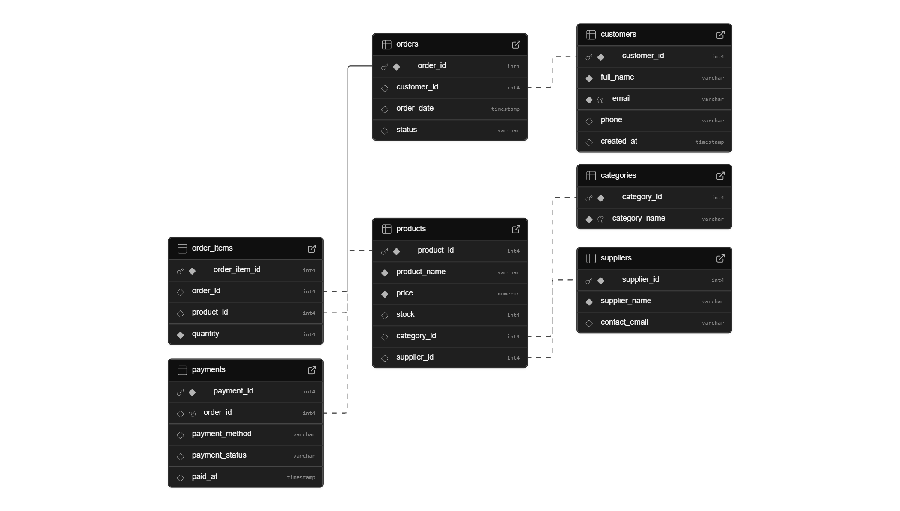

# E-commerce Data Engineering Project

An end-to-end data engineering project for an e-commerce platform. It covers **relational database design (ERD)**, **PostgreSQL implementation on Supabase**, **analytical SQL queries**, and a **REST API layer tested with Postman**.

---

## Tech Stack
| Layer | Tool |
|---|---|
| Database | PostgreSQL (Supabase) |
| Data Modeling | dbdiagram.io (ERD) |
| API Layer | Supabase REST API (PostgREST) |
| API Testing | Postman |
| Language / Format | SQL, JSON |

---

## Project Structure
```
ecommerce-data-engineering/
├── database/          # DDL schema + sample data (schema.sql, ecommerce_schema.sql)
├── erd/               # ERD diagrams
├── sql_queries/       # 15 analytical queries (queries.sql)
├── rest_api/          # Postman collection (20 endpoints)
├── screenshots/       # Query result screenshots
└── README.md
```

---

## Database Design (ERD)
**Entities:** Customers, Categories, Suppliers, Products, Orders, Order Items, Payments

**Relationships:**
- One-to-Many: Customers → Orders
- One-to-Many: Categories → Products
- One-to-Many: Suppliers → Products
- Many-to-Many: Orders ↔ Products (resolved via `order_items`)
- One-to-One: Orders → Payments

### ERD (dbdiagram.io)


### Supabase Schema Visualizer


---

## Database Implementation
- Tables created with SQL DDL in PostgreSQL (Supabase)
- Primary keys, foreign keys, `NOT NULL`, `UNIQUE` and `CHECK` constraints for data integrity
- Sample data inserted to simulate real-world e-commerce transactions

Files: [`database/schema.sql`](database/schema.sql), [`sql_queries/queries.sql`](sql_queries/queries.sql)

---

## SQL Queries & Results

| # | Query | Screenshot |
|---|---|---|
| 1 | Retrieve all customers | [view](screenshots/1%20Retrieve%20all%20customers.png) |
| 2 | List all products sorted by price (highest first) | [view](screenshots/2%20List%20all%20products%20sorted%20by%20price%20%28highest%20first%29.png) |
| 3 | Products with their category names | [view](screenshots/3%20Get%20all%20products%20with%20their%20category%20names.png) |
| 4 | Products with supplier information | [view](screenshots/4%20Get%20all%20products%20with%20supplier%20information.png) |
| 5 | Count total number of customers | [view](screenshots/5%20Count%20total%20number%20of%20customers.png) |
| 6 | Total number of orders per customer | [view](screenshots/6%20Total%20number%20of%20orders%20per%20customer.png) |
| 7 | Average price of all products | [view](screenshots/7%20Average%20price%20of%20all%20products.png) |
| 8 | Total quantity of items per order | [view](screenshots/8%20Total%20quantity%20of%20items%20per%20order.png) |
| 9 | Orders with customer names and status | [view](screenshots/9%20Orders%20with%20customer%20names%20and%20status.png) |
| 10 | Orders that have no payment record | [view](screenshots/10%20Orders%20that%20have%20no%20payment%20record.png) |
| 11 | Total revenue from all orders | [view](screenshots/11%20Total%20revenue%20generated%20from%20all%20orders.png) |
| 12 | Products with low stock (< 20) | [view](screenshots/12%20Products%20with%20low%20stock%20%28less%20than%2020%29.png) |
| 13 | Number of products in each category | [view](screenshots/13%20Number%20of%20products%20in%20each%20category.png) |
| 14 | Customers who placed completed orders | [view](screenshots/14%20Customers%20who%20placed%20completed%20orders.png) |
| 15 | Payment details with customer name | [view](screenshots/15%20Payment%20details%20with%20customer%20name.png) |

### Highlights
**Products with category names (JOIN)**


**Orders with no payment record (LEFT JOIN / anti-join)**


**Total revenue (aggregation)**


**Products per category (GROUP BY)**


---

## REST API
- Database exposed via **Supabase auto-generated REST APIs**
- **20 endpoints** covering full CRUD (GET / POST / PATCH / DELETE)
- Filtering, ordering and embedded relations using PostgREST query syntax
- Authenticated with the Supabase publishable (anon) API key
- Tested in Postman — import [`rest_api/E-commerce.postman_collection.json`](rest_api/E-commerce.postman_collection.json)

Example:
```http
GET https://<project>.supabase.co/rest/v1/products?select=*,categories(name)&order=price.desc
apikey: <SUPABASE_ANON_KEY>
```

---

## How to Run
1. Create a free project on [Supabase](https://supabase.com).
2. Open the SQL Editor and run `database/schema.sql`.
3. Run queries from `sql_queries/queries.sql`.
4. Import the Postman collection, set your project URL and anon key, and send requests.

---

## Key Learnings
- Normalized relational modeling and resolving many-to-many relationships
- Enforcing referential integrity with constraints
- Writing analytical SQL: JOINs, aggregations, GROUP BY, anti-joins
- Exposing a database as a REST API and testing it end-to-end
